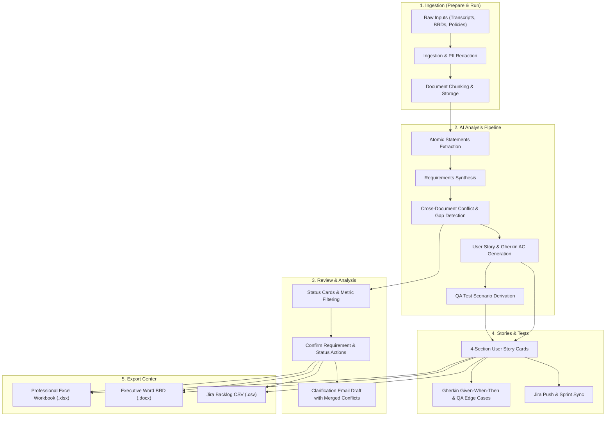
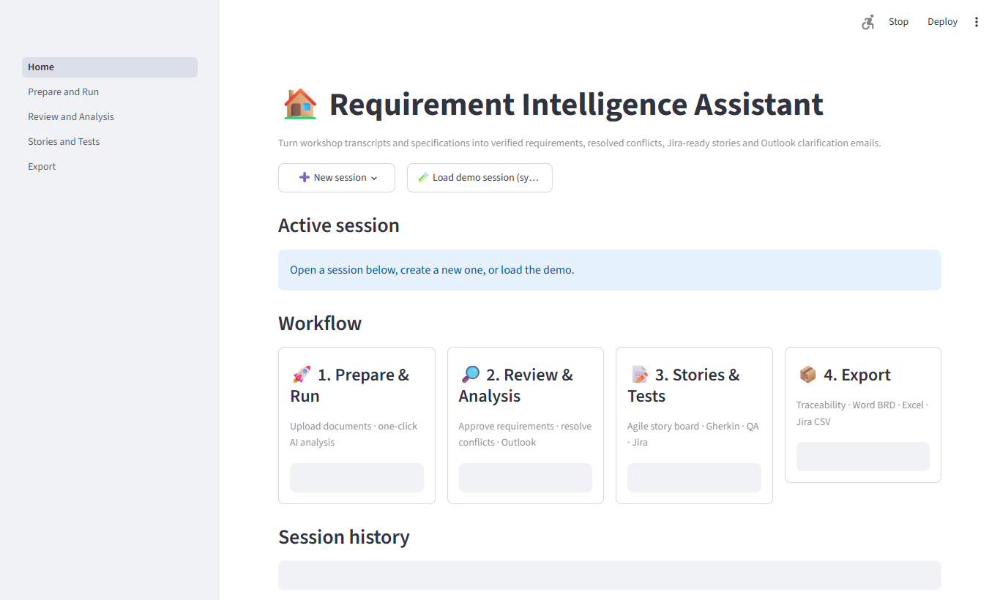
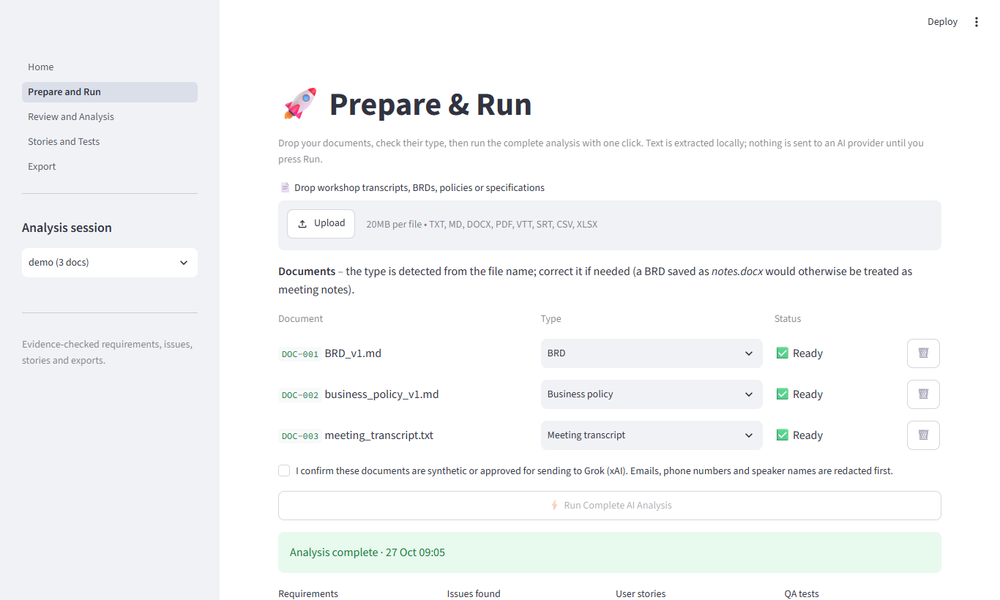
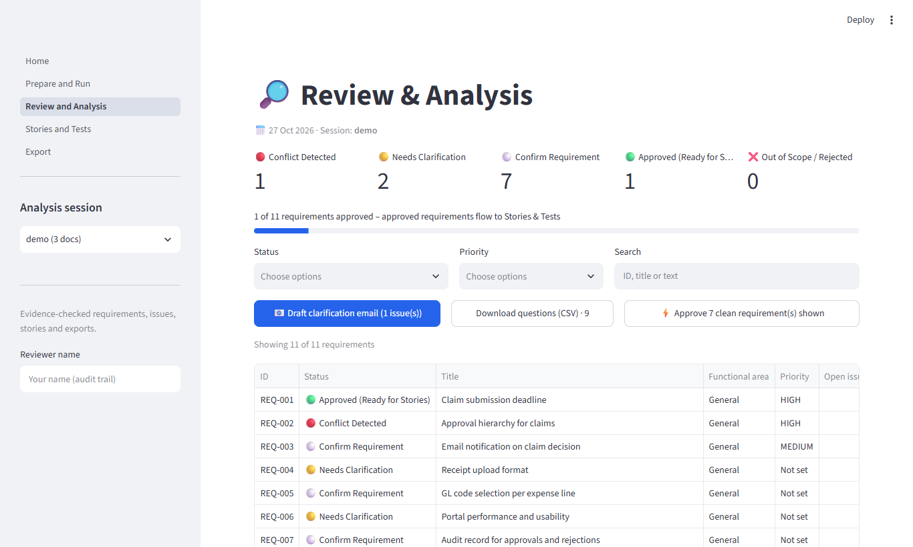
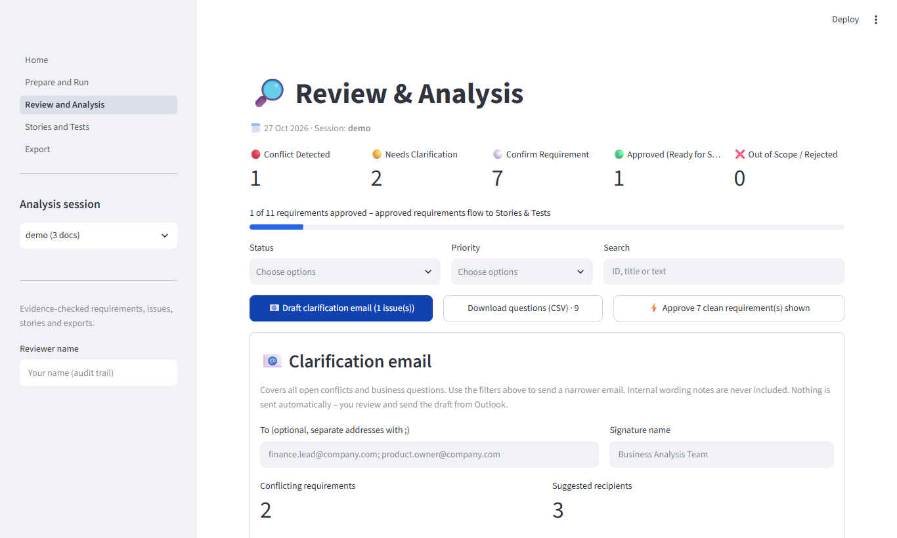
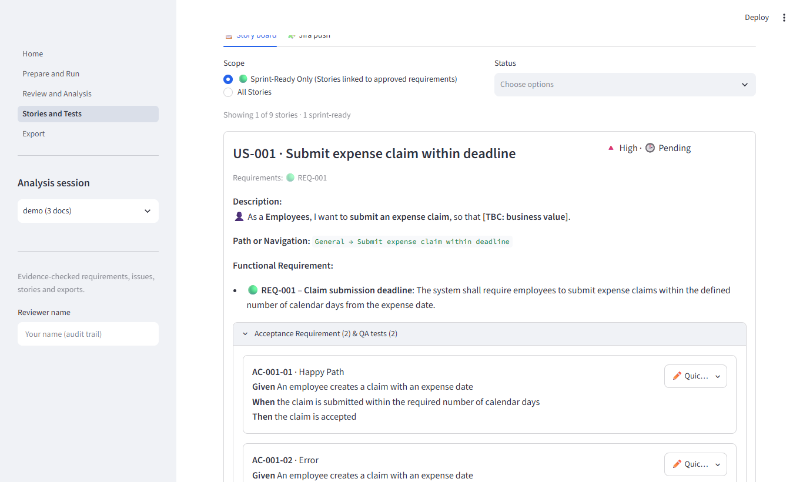
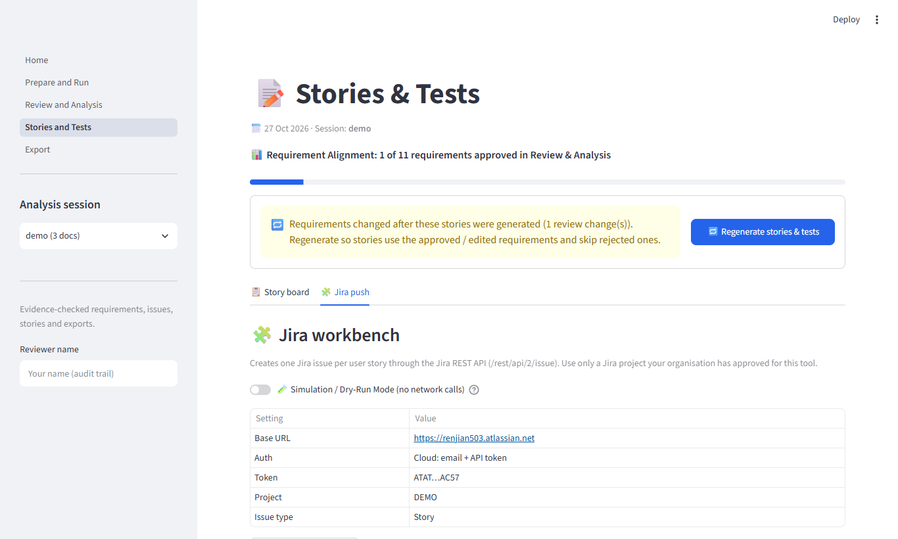
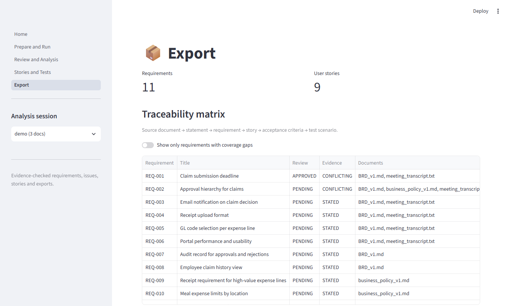

# Requirement Intelligence Assistant (RIA) — End-to-End Walkthrough Guide

The **Requirement Intelligence Assistant (RIA)** is an enterprise-grade AI solution designed for Business Analysts, Product Managers, and QA Engineers. It automates the extraction, reconciliation, and transformation of raw business inputs (meeting transcripts, BRDs, policy PDFs) into validated requirements, user stories, Gherkin acceptance criteria, and automated QA test scenarios.

---

## Complete Workflow Overview

The diagram below illustrates the end-to-end data lifecycle across all five stages of RIA:

---

## 🎥 Walkthrough Video

A complete video recording walking through every screen and interaction is available:

- 🎬 **Watch Walkthrough Video**: [ria_walkthrough_video.webm](videos/ria_walkthrough_video.webm)

> [!TIP]
> You can open the `.webm` video directly in Google Chrome, Microsoft Edge, or VLC media player to view the full live walkthrough.

---

## Detailed Step-by-Step Flow

### Stage 1: Home Dashboard & Session Workspace

The RIA dashboard serves as the central management console for all requirement analysis sessions.

#### Key Capabilities:
1. **Active Session Overview**: Displays the currently active session identifier, creation timestamp, and quick-action navigation cards.
2. **Session Switching**: Seamlessly toggle between different client projects, releases, or sprints.
3. **Session Management**: Create fresh sessions with custom naming, clone previous sessions for delta analysis, or delete outdated working sessions.
4. **Clean Interface**: Provider configurations and telemetry are tucked away cleanly to keep the dashboard focused on requirements governance.

---

### Stage 2: Document Ingestion (Prepare & Run)

In the **Prepare & Run** module, teams upload their source material. RIA supports heterogeneous multi-format ingestion.

#### Ingestion Workflow:
1. **Document Upload**:
   - Drag and drop files directly into the uploader.
   - Supported file types: `.txt`, `.md`, `.docx`, `.pdf`, `.vtt`, `.srt`, `.csv`.
2. **Document Classification**:
   - Select the business document type: **Meeting Transcript**, **BRD / PRD**, **Policy / Compliance Document**, or **Architecture Spec**.
3. **Extraction & Sanitization**:
   - Files are automatically parsed, segment-indexed, and scrubbed of sensitive PII (names, phone numbers, email addresses, financial identifiers) before any AI call.
4. **Document Inventory**:
   - The table displays Document ID (`DOC-001`), filename, document type, file size, ingestion timestamp, and parsing status.

---

### Stage 3: AI Pipeline Execution (Prepare & Run)

Once source documents are staged, the AI intelligence engine reconciles the material.

#### Execution Settings:
1. **Analysis Mode**:
   - **Cross-document reconciliation**: Compare spoken meeting agreements against formal written documentation to highlight discrepancy risks.
   - **Transcript only**: Fast-track extraction from agile grooming or stakeholder workshops.
2. **Analysis Depth**:
   - **Quick Analysis**: High-speed extraction prioritizing core requirements and critical blockers.
   - **Deep Analysis**: Comprehensive extraction with full edge-case matrix and bidirectional traceability.
3. **Execution**:
   - Click **🚀 Run Analysis** to trigger the deterministic pipeline:
     1. Ingest & extract atomic statements.
     2. Deduce normalized functional and non-functional requirements.
     3. Identify cross-document contradictions and coverage gaps.
     4. Generate agile user stories with Gherkin acceptance criteria.
     5. Synthesize QA positive and negative test scenarios.

---

### Stage 4: Review & Analysis Workbench

The **Review & Analysis** screen provides an interactive approval matrix where business analysts validate and refine findings.

#### Governance Highlights:
1. **Dynamic Metric Cards**:
   - **Confirm Requirement**: Instant view of requirements marked as confirmed and ready for downstream sprint planning.
   - **Pending Review**: Items awaiting team review.
   - **Approved**: Validated specifications.
   - **Flagged & Needs Clarification**: Items with unresolved ambiguities or contradictory sources.
2. **Requirements Table**:
   - Displays Requirement ID (`REQ-001`), Category (`FUNCTIONAL`, `INTEGRATION`, `SECURITY`), Title, Source Document references, and Review Status.
3. **Quick Inline Actions**:
   - Accept, Flag, Edit, or Mark for Clarification directly from each row.

---

### Stage 5: Stakeholder Clarification Email

When RIA detects contradictions between stakeholders or between transcripts and written BRDs, it automates stakeholder resolution.

#### Key Features:
1. **Automated Conflict Synthesis**:
   - Detects concrete discrepancies (e.g., *Transcript states 30-day retention, but BRD specifies 90 days*).
2. **Consolidated Table**:
   - All conflicts are merged into a single clean table formatted with:
     - Conflict Title & Description
     - Impacted Requirement ID
     - Meeting vs BRD Source Evidence
     - Explicit Question for the Product Owner
3. **Direct Outlook Dispatch**:
   - Click **Open Directly in Outlook** to launch a formatted draft email via local Windows Outlook COM automation, pre-populated with recipient fields, formatted HTML tables, and subject line.

---

### Stage 6: Agile Stories & QA Test Scenarios

The **Stories & Tests** workbench bridges the gap between requirements and technical delivery.

#### Standardized 4-Section User Story Architecture:
Every user story is structured in the required delivery format:

1. **Description**:
   - The user story narrative: `As a [Role], I want [Feature], So that [Benefit]`.
2. **Path or Navigation**:
   - Explicit navigation route where the capability is located (e.g., `Settings > Security & Privacy > Data Retention Policy`).
3. **Functional Requirement**:
   - Complete, unabridged functional requirement text linking directly to the business mandate.
4. **Acceptance Requirement & QA Tests**:
   - Formal Gherkin Given-When-Then acceptance criteria with inline quick-editing.
   - Categorized QA test scenarios: **Happy Path** positive flows and **Edge Cases / Error Handling** negative flows with numbered test steps and expected results.

---

### Stage 7: Direct Jira Integration

Seamlessly transition sprint-ready user stories and test scenarios directly into your issue tracking system.

#### Capabilities:
1. **Jira Live Connection**:
   - Configure Jira Cloud / Server URL, project key, and API credentials.
   - Built-in **🔌 Test Connection** validation.
2. **Direct Push**:
   - Push individual user stories or bulk-push all approved sprint-ready stories.
   - Automatically synchronizes story descriptions, acceptance criteria, and priority tags.
   - Captures Jira issue keys (`PROJ-101`) and provides direct hyperlinks into the active backlog.

---

### Stage 8: Multi-Format Export Center

The **Export Center** packages validated requirements into production-ready deliverables.

#### Supported Deliverables:
1. **Excel Multi-Tab Workbook (`.xlsx`)**:
   - **Summary Sheet**: Clean metric summary table with live dynamic status count formulas.
   - **Requirements Sheet**: Full functional requirements catalog with statuses, sources, and categories.
   - **Findings & Questions Sheet**: Unified single sheet consolidating cross-document findings, gaps, and clarification questions.
   - **User Stories & Scenarios Sheets**: Full agile specifications and test matrices.
2. **Executive Word BRD (`.docx`)**:
   - Formatted Word document with executive summary, scope, atomic requirements, conflict resolution log, and stakeholder sign-off block.
3. **Jira Backlog CSV (`.csv`)**:
   - Pre-formatted CSV file ready for one-click bulk import into Jira, Azure DevOps, or Linear.

---

## Summary Checklist for Project Teams

| Phase | Activity | Recommended Tool / View |
| :--- | :--- | :--- |
| **1. Preparation** | Ingest Transcripts, BRDs, and Policies | `Prepare & Run` → Drag & Drop |
| **2. Analysis** | Run Cross-Document AI Pipeline | `Prepare & Run` → `🚀 Run Analysis` |
| **3. Review** | Validate requirements & check "Confirm Requirement" | `Review & Analysis` → Metric Cards |
| **4. Resolution** | Review merged conflicts & dispatch email | `Review & Analysis` → `Draft clarification email` → `Open Directly in Outlook` |
| **5. Stories & QA** | Inspect 4-section user stories & test cases | `Stories & Tests` → `📋 Story board` |
| **6. Backlog Sync** | Push sprint-ready items to Jira | `Stories & Tests` → `🧩 Jira push` |
| **7. Sign-off** | Download Excel Workbook and Word BRD | `Export` → One-click downloads |
